<a href="https://portafolio.classify.in.net">
  <picture>
    <source media="(prefers-color-scheme: dark)" srcset="assets/banner-oscuro.webp">
    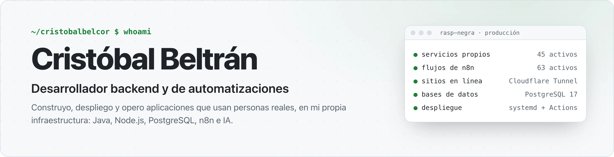
  </picture>
</a>

 

  <a href="https://portafolio.classify.in.net"><picture><source media="(prefers-color-scheme: dark)" srcset="assets/btn-portafolio-oscuro.webp"></picture></a>
  <a href="https://www.linkedin.com/in/cristobal-beltran-cortes/"><picture><source media="(prefers-color-scheme: dark)" srcset="assets/btn-linkedin-oscuro.webp"></picture></a>
  <a href="mailto:cristobalbelcor@gmail.com"><picture><source media="(prefers-color-scheme: dark)" srcset="assets/btn-correo-oscuro.webp"></picture></a>

## ⌁ Hola, soy Cristóbal

Desarrollador backend y de automatizaciones en Colombia. No me quedo en el código: **lo despliego y lo opero**.
Mis aplicaciones las usan todos los días los pacientes de una psicóloga clínica, más de 1.500 docentes que se preparan
para el concurso, estudiantes universitarios y los inquilinos de una casa, y corren en servidores que administro yo.

  <picture>
    <source media="(prefers-color-scheme: dark)" srcset="assets/terminal-oscuro.svg">
    
  </picture>

- 💼 Automatizaciones para **clientes internacionales** con AutosMatrix (Upwork): n8n, Make, Zapier, GoHighLevel, CRMs y agentes con IA.
- 🖥️ Opero mi propia infraestructura: **2 Raspberry Pi y un droplet** con 45 servicios en systemd, PostgreSQL, nginx, Docker, Cloudflare Tunnel y 63 flujos de n8n.
- 🎓 **Tecnólogo en Análisis y Desarrollo de Software** (SENA) · estudiante de **Ingeniería de Sistemas** (Universidad del Tolima).
- 🤖 Trabajo con agentes de IA (Claude Code) como parte del equipo: skills propias, revisiones y despliegues.

<b>🇬🇧 Read in English</b>

 

Backend and automation developer from Colombia. I don't stop at the code: **I deploy it and I run it**. My apps are used
every day by a clinical psychologist's patients, 1,500+ teachers preparing for the national exam, university students
and the tenants of a house, and they run on servers I manage myself.

- 💼 Business automation for **international clients** with AutosMatrix (Upwork): n8n, Make, Zapier, GoHighLevel, CRMs and AI agents.
- 🖥️ I run my own infrastructure: **2 Raspberry Pis and a droplet** with 45 systemd services, PostgreSQL, nginx, Docker, Cloudflare Tunnel and 63 n8n workflows.
- 🎓 **Software Analysis and Development Technologist** (SENA) · **Systems Engineering** student (Universidad del Tolima).
- 🤖 I work with AI agents (Claude Code) as part of the team: custom skills, reviews and deployments.

 

## ⌁ Proyecto principal

<a href="https://acriz.classify.in.net">
  <picture>
    <source media="(prefers-color-scheme: dark)" srcset="assets/proyecto-cuadri-principal-oscuro.webp">
    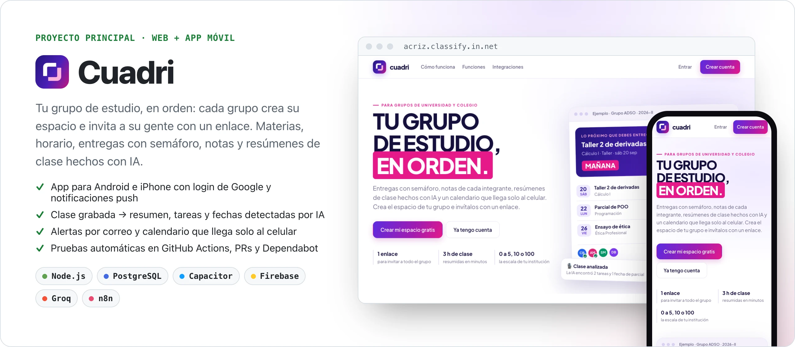
  </picture>
</a>

  <a href="https://acriz.classify.in.net"><b>Abrir Cuadri ↗</b></a> &nbsp;·&nbsp;
  <a href="https://portafolio.classify.in.net/#proyectos"><b>Ver en el portafolio</b></a>

 

## ⌁ Más proyectos en producción

  <a href="https://lasgafasdelprofe.com"><picture><source media="(prefers-color-scheme: dark)" srcset="assets/proyecto-gafas-oscuro.webp">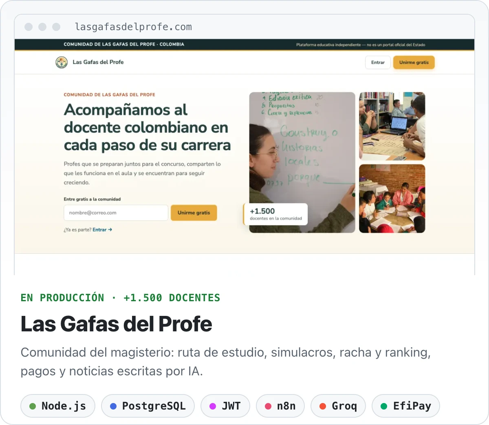</picture></a>
  <a href="https://maribelpenaduran.com"><picture><source media="(prefers-color-scheme: dark)" srcset="assets/proyecto-maribel-oscuro.webp"></picture></a>

  <a href="https://classify.in.net"><picture><source media="(prefers-color-scheme: dark)" srcset="assets/proyecto-classify-oscuro.webp">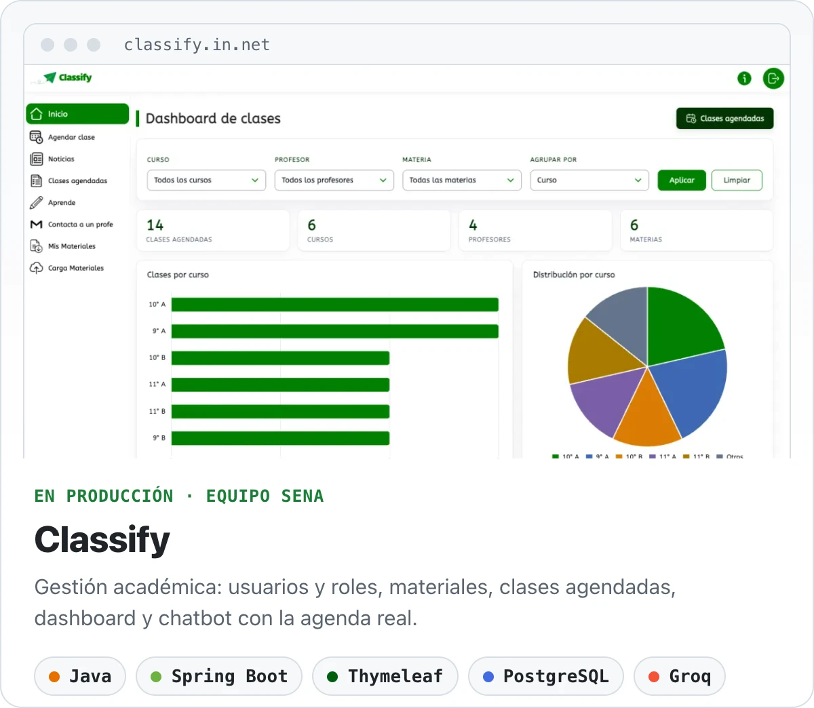</picture></a>
  <a href="https://finanzas.classify.in.net"><picture><source media="(prefers-color-scheme: dark)" srcset="assets/proyecto-finanzas-oscuro.webp">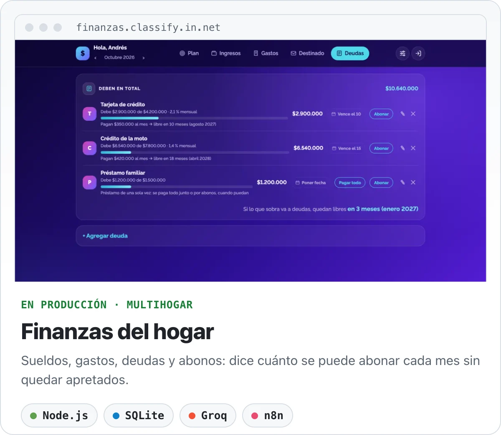</picture></a>

  <a href="https://portafolio.classify.in.net/#proyectos"><picture><source media="(prefers-color-scheme: dark)" srcset="assets/proyecto-evaluaciones-oscuro.webp">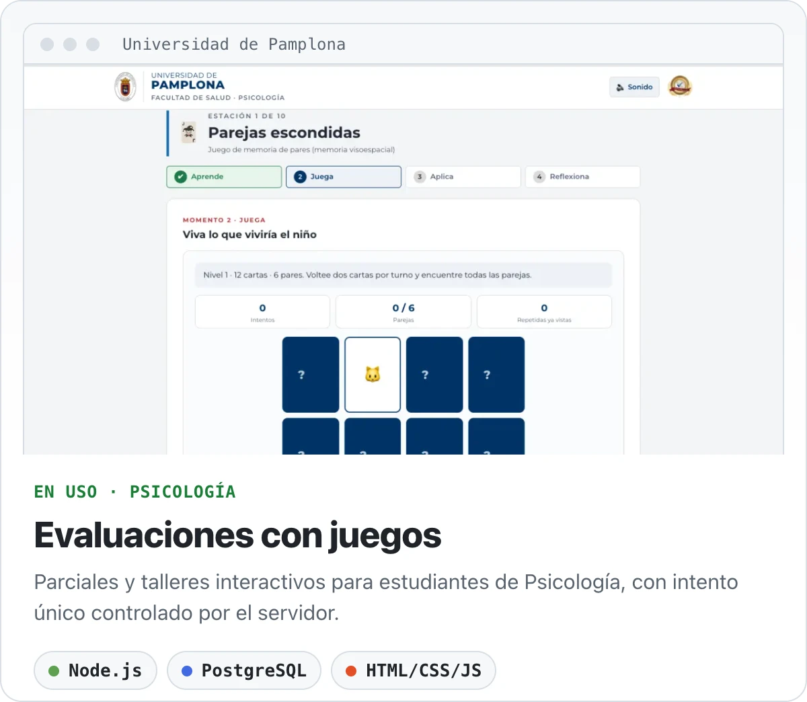</picture></a>
  <a href="https://servicios.classify.in.net"><picture><source media="(prefers-color-scheme: dark)" srcset="assets/proyecto-servicios-oscuro.webp">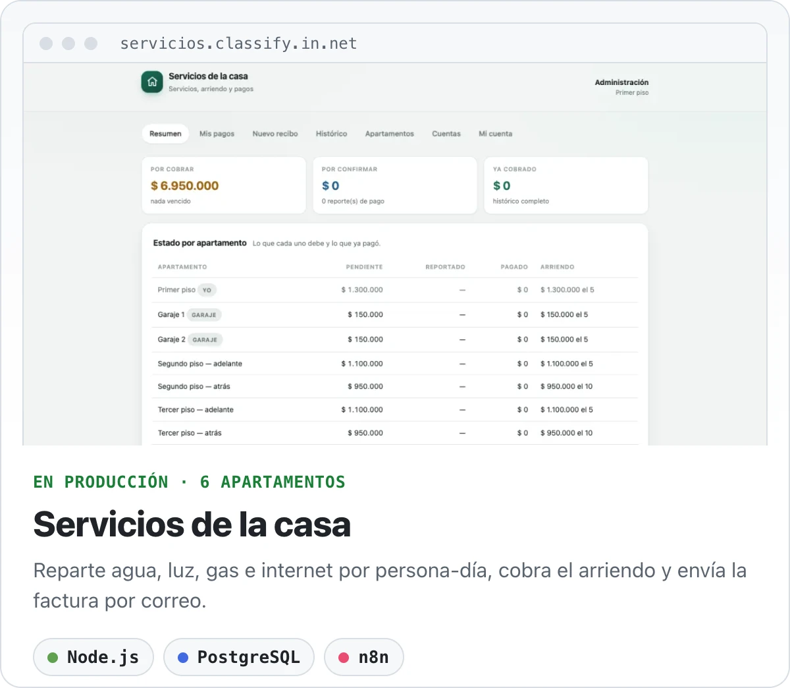</picture></a>

  <a href="https://voz.classify.in.net"><picture><source media="(prefers-color-scheme: dark)" srcset="assets/proyecto-voz-oscuro.webp">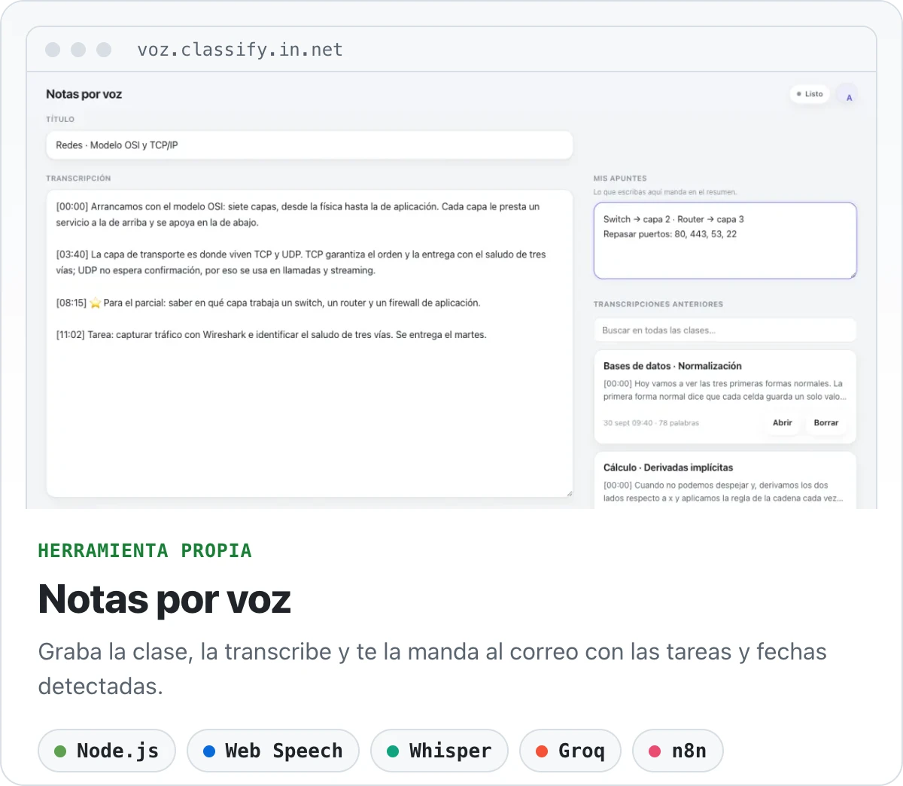</picture></a>
  <a href="https://github.com/cristobalbelcor/monamy"><picture><source media="(prefers-color-scheme: dark)" srcset="assets/proyecto-monamy-oscuro.webp">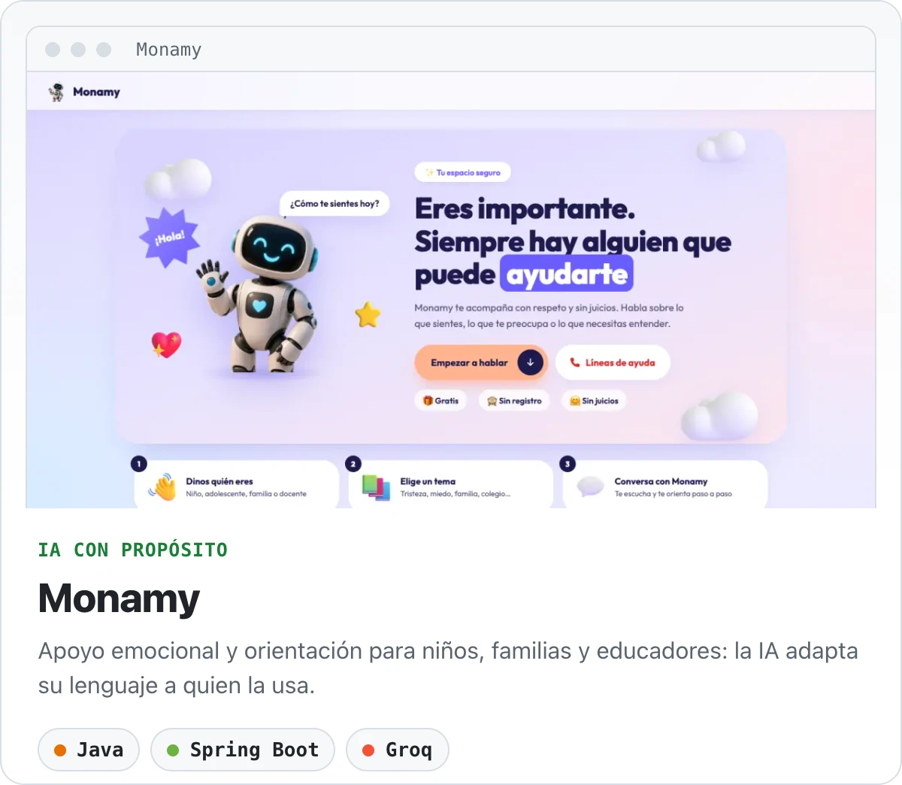</picture></a>

<b>Ver más proyectos</b>

 

| Proyecto | Qué es | Con qué |
|---|---|---|
| **Mi Ruta** | Orientación vocacional y plan de recuperación académica para adolescentes (check-in, Modo rescate, Mi semana) | Node.js · PostgreSQL |
| **Conócete** | Orientación vocacional con informe generado por IA | Node.js · PostgreSQL · Groq |
| **Ruta de ansiedad** | Cuadernillo clínico de ansiedad y estrés, por etapas | Node.js · PostgreSQL |
| **Pruebas psicológicas** | 16PF, inventarios de Beck (ansiedad y depresión), TDAH en adultos y Rueda de la Vida, con informe para la psicóloga | Node.js · PostgreSQL · n8n |
| **Simulacro «La anomalía»** | Evaluación de intento único para docentes: la integridad vive en el servidor | Node.js · PostgreSQL |
| **Nexo** | Tareas y entregas de mi grupo de la universidad, con asistente | Node.js · Groq |
| **Dante** | Asistente de la casa con panel en vivo | Node.js · Groq · SSE |
| **Mascota en Alexa** | Mascota que habla por Alexa y muestra el estado del servidor en vivo | Node.js · Alexa · SSE |
| **Herramientas del equipo** | Librería de repos y herramientas que la IA resume y clasifica sola | Python · SQLite · Groq |
| **Directorio ADSO** | Postulación a contratos de aprendizaje del SENA, enviada desde el Gmail de cada aprendiz | n8n · Gmail · PDF |
| **Videos con código** | Videos publicitarios generados con React | React · Remotion |
| **Transcriptor de voz** | API de transcripción de audio a texto en español, 100 % offline | Python · FastAPI · Vosk |

<a href="https://portafolio.classify.in.net/#mas-proyectos"><b>Todos los proyectos en el portafolio →</b></a>

  <a href="https://portafolio.classify.in.net/#automatizaciones"><b>⌁ Ver las automatizaciones (n8n, Make, Zapier, GoHighLevel) →</b></a>

 

## ⌁ Tecnologías que uso

  <picture>
    <source media="(prefers-color-scheme: dark)" srcset="assets/stack-oscuro.webp">
    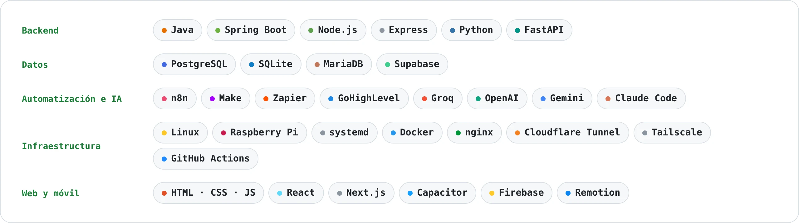
  </picture>

<b>¿Dónde uso cada una?</b>

 

| Tecnología | Dónde la usé |
|---|---|
| **Java · Spring Boot** | Classify · Monamy · programa de ansiedad |
| **Node.js** (sin framework y con Express) | Cuadri · Las Gafas del Profe · consultorio · finanzas · servicios · evaluaciones · Nexo · Dante |
| **PostgreSQL** | Cuadri · Las Gafas · Classify · consultorio (15 apps) · servicios · evaluaciones |
| **SQLite** | Finanzas del hogar (un archivo por hogar) · herramientas del equipo |
| **n8n** (63 flujos activos) | Correos, avisos, pagos, noticias con IA, bots de Telegram, Jira/GitHub → Google Chat |
| **Make · Zapier · GoHighLevel** | Automatizaciones para clientes internacionales |
| **IA** (Groq, OpenAI, Gemini, Whisper) | Resúmenes de clase, noticias, clasificación de gastos, chatbots, informes de pruebas |
| **Capacitor · Firebase** | App móvil de Cuadri (Android e iPhone, push, login de Google) |
| **Pagos** (EfiPay) | Consultorio · Las Gafas del Profe |
| **Infraestructura** (systemd, nginx, Docker, Cloudflare Tunnel, Tailscale) | Todos los proyectos: 2 Raspberry Pi y un droplet |
| **GitHub Actions** | Pruebas de Cuadri · despliegue de Classify · este perfil |
| **Python** | Herramientas del equipo · recolector de vacantes · documentación generada por código |
| **React · Remotion · Next.js** | Videos publicitarios · rifa |

 

## ⌁ Mi actividad

  <picture>
    <source media="(prefers-color-scheme: dark)" srcset="https://raw.githubusercontent.com/cristobalbelcor/cristobalbelcor/output/stats-oscuro.svg">
    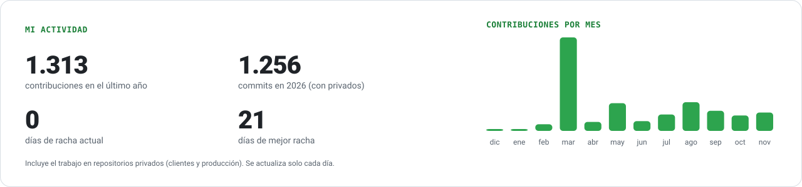
  </picture>

  <picture>
    <source media="(prefers-color-scheme: dark)" srcset="https://raw.githubusercontent.com/cristobalbelcor/cristobalbelcor/output/snake-oscuro.svg">
    
  </picture>

 

  <i>«Hablar es fácil. Muéstrame el código.»</i> — Linus Torvalds

  💬 Abierto a oportunidades remotas como desarrollador backend o de automatizaciones.

